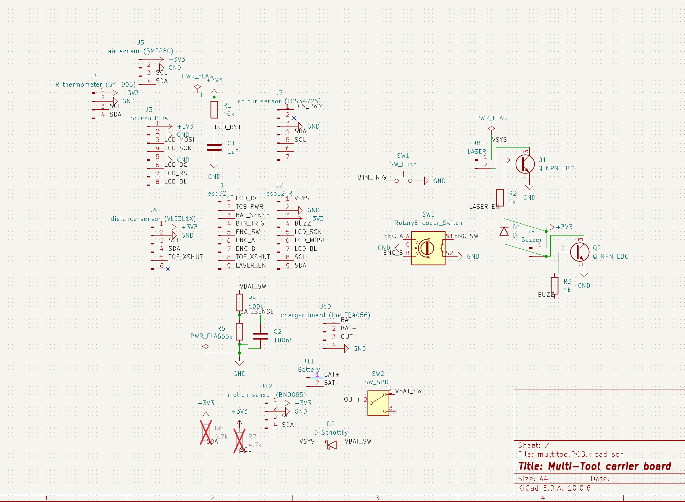
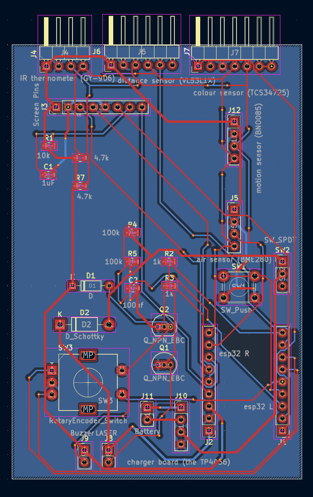
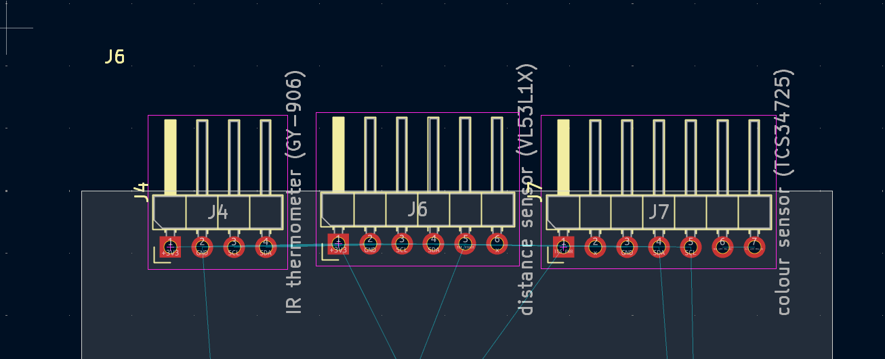
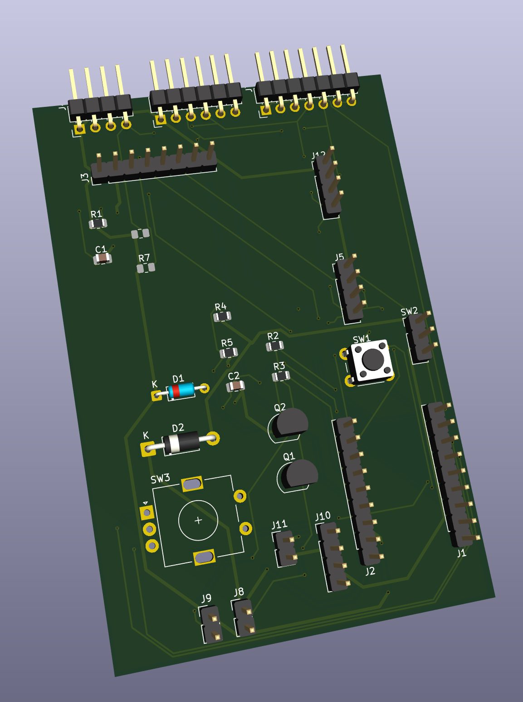

# E-Multitool

[BOM.md](https://github.com/user-attachments/files/33780918/BOM.md)
# Bill of Materials

| Item | What it's for | Qty | Supplier | Cost/item | Total Cost |
|---|---|---|---|---|---|
| TCS34725 colour sensor (7 pins with white LED) | Reads the colour of whatever it's pointed at | 1 | AliExpress | $2.50 | $2.50 |
| GY-BME280-3.3 air sensor | Measures air pressure, temperature and humidity | 1 | AliExpress | $3.50 | $3.50 |
| TP4056 USB-C charger with DW01 protection | Charges the battery and protects it from over-discharge | 1 | AliExpress | $1.53 | $1.53 |
| TZT 650nm 5mW 6mm laser dot module | Shows where the tool is pointing | 1 | AliExpress | $0.32 | $0.32 |
| Passive piezo buzzer 3.3V | Beeps when a measurement is done | 1 | AliExpress | $0.50 | $0.50 |
| NPN transistor TO-92 (S8050 or 2N3904) | Switches the laser and the buzzer on and off | 2 | AliExpress | $0.50 | $1.00 |
| Schottky diode 1N5819 DO-41 | Stops USB power from pushing back into the battery | 1 | AliExpress | $0.50 | $0.50 |
| Resistor bags 0805 (10k, 1k, 100k, 4.7k) | Screen reset, transistor bases, battery level reading, I2C pull-ups | 4 | AliExpress | $0.40 | $1.60 |
| Capacitor bags 0805 25V (1uF, 100nF) | Screen reset and a steady battery reading | 2 | AliExpress | $0.45 | $0.90 |
| Female pin header 2.54mm 8 pins | Lets the screen plug into the board | 1 | AliExpress | $0.50 | $0.50 |
| Estimated total shipping | | 1 | | $18.60 | $18.60 |
| **Total** | | | | | **$31.45** |
